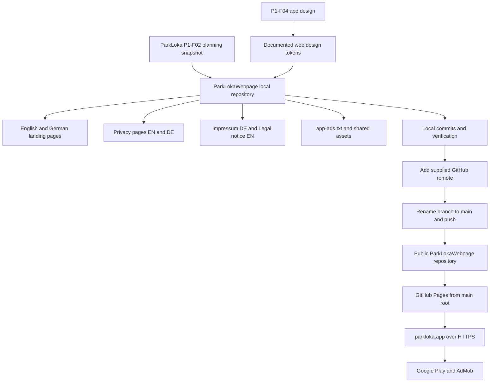

# P1-F02 — GitHub Pages website and legal presence

> Status: in-progress
> Phase: 1
> Brainstormed: 2026-08-18

## 1. Summary & scope

Create a simple bilingual website for ParkLoka as an independent public repository in `C:\Users\igorm\AndroidStudioProjects\ParkLokaWebpage`, hosted free through GitHub Pages. The website introduces the application, provides public English and German privacy-policy and legal-notice pages, supports AdMob verification, and acts as the developer website for the Google Play listing. Its visual system follows the completed P1-F04 Android design, while the existing AutoWave website remains a structural reference rather than a source of ParkLoka-specific content or branding.

**In scope:**

- A dependency-free static website in the separate `ParkLokaWebpage` folder and Git repository.
- Static site files published directly from the website repository root.
- English and German landing pages.
- English Privacy Policy and German Datenschutzerklärung.
- German Impressum and English Legal notice.
- The supplied developer identity, address, email, and VAT ID.
- Shared responsive styling and local static assets.
- A language switch on every public page.
- GitHub Pages publication from the public repository's `main` branch and root directory.
- Custom-domain configuration for `parkloka.app`.
- HTTPS verification and correct canonical URLs.
- Root-level `app-ads.txt` output for AdMob.
- Basic metadata, accessibility, SEO, sitemap, robots file, and 404 page.
- Google Play download link or development-state placeholder.
- No analytics, advertising, cookies, contact form, or tracking on the website.
- Visual continuity with ParkLoka's branded light/dark palettes, typography, shapes, spacing, icons, and action hierarchy.

**Out of scope:**

- A JavaScript framework, CMS, database, backend, or server-side rendering.
- Paid web hosting or paid deployment services.
- User accounts, comments, blog, newsletter, or dynamic support system.
- Website analytics or tracking pixels.
- Languages other than English and German.
- Duplicating or exposing locally stored application parking data.
- Building the Android application itself.
- Storing website implementation files inside the Android `ParkLoka` repository.
- A Git submodule or shared build between the Android and website repositories.
- Automatic domain purchase or DNS changes without explicit authorization.

## 2. Decisions

| # | Decision | Rejected alternative(s) | Why |
|---|----------|------------------------|-----|
| 1 | Build and maintain the website in the independent sibling folder `C:\Users\igorm\AndroidStudioProjects\ParkLokaWebpage`, backed by its own public repository. | Store website files in `ParkLoka/webpage`; use a Git submodule; mix website files into the Android app module. | GitHub Pages can publish the public website repository directly, while the private Android repository stays separate. |
| 2 | On the first execute session, initialize local Git in `ParkLokaWebpage`, copy this feature plan and a website-local roadmap into that repository, and make that copy the execution source of truth. | Update website code in one repository and the delivery log in another. | Feature-flow requires each task's code and feature-document update to live in the same commit. The ParkLoka copy remains the cross-project planning snapshot. |
| 3 | Use plain semantic HTML and shared CSS with minimal optional vanilla JavaScript. | React, Next.js, Astro, Jekyll, or another build framework. | The site is small and mostly legal content; a framework would increase maintenance without adding user value. |
| 4 | Publish the static files directly from the public repository's `main` branch root. | GitHub Actions deployment from a nested source folder; generated publishing branch. | A dedicated static-site repository needs no build or copy step and matches the proven AutoWave publication model. |
| 5 | Treat the completed P1-F04 Android design as the visual source of truth. | Give the website an unrelated theme; copy AutoWave's teal radio identity. | Shared navy/lavender and light palettes, system typography, rounded shapes, spacing rhythm, icon style, and action hierarchy make the two products feel intentionally connected. |
| 6 | Mirror design values through documented CSS custom properties rather than sharing generated code across repositories. | Couple CSS generation to the Android Gradle build; duplicate values without documentation. | A small explicit token table is easy to audit and keeps both repositories independently buildable. |
| 7 | Use `parkloka.app` as the custom domain, subject to ownership and DNS confirmation. | Using only the default `github.io` project URL. | The domain matches the contact email and provides stable Play Console, privacy-policy, and AdMob URLs. |
| 8 | Use English at `/` and German at `/de/`. | Browser-language redirects or separate domains. | Stable explicit URLs are simple, indexable, accessible, and do not depend on JavaScript. |
| 9 | Publish legal pages at stable language-specific paths. | One mixed-language legal document. | Google Play and users need clear, directly linkable privacy information in the relevant language. |
| 10 | Use shared CSS and locally stored assets. | Repeating inline CSS from the AutoWave example or loading Google Fonts. | Shared files avoid duplicated maintenance, while local or system fonts prevent an unnecessary third-party request and privacy disclosure. |
| 11 | Keep the website free of analytics, advertising, cookies, and forms. | Google Analytics, tracking pixels, ad banners, or a server-backed contact form. | The website exists for product information and compliance; tracking would add consent and privacy complexity. |
| 12 | Maintain one implementation-specific privacy-policy source synchronized with P1-F01. | Copying the WaveLoka privacy policy and replacing only the product name. | WaveLoka processes radio streams and different advertising behavior; ParkLoka's policy must describe only ParkLoka's actual data flows. |
| 13 | Disclose GitHub Pages as the website host and its technical logging behavior. | Claiming that the website processes no visitor data whatsoever. | GitHub Pages logs technical information such as visitor IP addresses for security purposes. |
| 14 | Publish `app-ads.txt` at the custom-domain root. | Keeping the file only in documentation or a subdirectory. | AdMob discovers the file through the developer website hostname and expects it at `/app-ads.txt`. |
| 15 | Keep the website local-only until all P1-F02 implementation tasks and commits are complete, then connect and push the supplied remote in the final task. | Add the remote or push partial work during earlier tasks. | The user explicitly wants the public repository connected only after the current website work is finished and verified. |
| 16 | Use AutoWave only as a structural and GitHub Pages reference. | Copying its visual identity, radio-specific legal text, or duplicated inline styles. | ParkLoka requires its own app-aligned identity and accurate legal disclosures. |

## 3. Diagram

## 4. Tasks

| ID | Task & acceptance criteria | Prompt draft | Status | Commit | Date |
|----|---------------------------|--------------|--------|--------|------|
| P1-F02-T1 | **Initialize the independent website repository and static foundation.** AC: `C:\Users\igorm\AndroidStudioProjects\ParkLokaWebpage` is a local Git repository with no remote; before implementation, this feature plan and a website-local roadmap are added and committed as `[P1-F02] Add feature plan`; static site files live at the repository root and include semantic EN/DE page shells, shared CSS, local asset directories, `.nojekyll`, and working relative navigation; the site can be served locally without Node, Docker, or a build step. Constraints: execute from the `ParkLokaWebpage` repository after the opening plan commit; no framework, package manager, external font, tracker, copied AutoWave branding, Android-repository website files, remote addition, or push. | Initialize the empty `ParkLokaWebpage` sibling folder as the independent feature-flow repository, migrate the P1-F02 plan into it as the execution source of truth, make the required opening plan commit, then create the dependency-free static root foundation with approved routes, shared CSS, accessible navigation, local assets, and local-preview documentation. | done | [P1-F02-T1] | 2026-08-19 |
| P1-F02-T2 | **Build an app-aligned bilingual ParkLoka landing experience.** AC: `/` presents English content and `/de/` presents equivalent German content; CSS custom properties document and reproduce P1-F04's dark and light semantic colors, system typography, 6/8/12/20/28 px rounded-shape scale, 8/16/24 px spacing rhythm, icon treatment, and primary/secondary/destructive hierarchy; the site follows `prefers-color-scheme`; both pages explain Save Location, Address and Coordinates, Distance, Approximate Walking Time, Photo, External Navigation, Sharing, and structured parking details without promising maps or automatic detection; layouts work across mobile and desktop widths. Constraints: ParkLoka is the visual source of truth; use concise copy and no map imagery, fake reviews, fabricated statistics, unsupported claims, or AutoWave teal/radio styling. | Inspect the completed P1-F04 Compose theme and representative ParkLoka screens, document the matching CSS tokens, and implement friendly EN/DE landing pages with the same visual identity, hero, three-step explanation, focused feature cards, local-first privacy message, Google Play CTA or development notice, support contact, and legal footer. | done | [P1-F02-T2] | 2026-08-19 |
| P1-F02-T3 | **Create bilingual legal and privacy pages.** AC: German Impressum and English Legal notice contain the supplied developer details accurately; English Privacy Policy and German Datenschutzerklärung describe ParkLoka's finalized location, Geocoder, local photo/note/structured-detail, external-intent, AdMob/UMP, retention, deletion, and rights behavior; website hosting by GitHub Pages is disclosed; all legal pages use the shared app-aligned design, cross-link, and have permanent URLs. Constraints: do not copy WaveLoka's radio, stream, audio-ad, or station language; mark legal text for final owner review. | Create ParkLoka-specific legal pages in both languages. Use the supplied Impressum data verbatim, synchronize privacy disclosures with the completed P1-F01/P1-F03 behavior, disclose GitHub Pages hosting and Google advertising services, and provide accessible language and back navigation within the shared design system. | done | [P1-F02-T3] | 2026-08-19 |
| P1-F02-T4 | **Add GitHub Pages, discovery, AdMob, and release assets.** AC: root `CNAME` contains `parkloka.app`; `app-ads.txt` is generated from a confirmed AdMob publisher record and will resolve at `https://parkloka.app/app-ads.txt`; robots, sitemap, canonical and hreflang metadata, social previews, favicon/app icon, 404 page, Play links, and instructions for Pages publication from `main`/root are present; no secret or AdMob application/ad-unit ID is exposed unnecessarily; automated checks detect broken internal links and missing required files. Constraints: confirm the publisher ID before publication; do not add a remote, push, configure DNS, or reuse the AutoWave publisher value by assumption. | Add the static root assets and checks required for GitHub Pages, Play, search engines, social previews, and AdMob. Prepare `CNAME`, document branch-root Pages settings and expected public URLs, and keep the repository local-only. | done | [P1-F02-T4] | 2026-08-19 |
| P1-F02-T5 | **Verify visual consistency and local release readiness.** AC: app and website are compared side by side in light/dark and EN/DE states; shared colors, typography, shapes, spacing, icons, and action hierarchy are documented and materially consistent; every local route succeeds at mobile and desktop widths; keyboard navigation, semantics, contrast, reduced motion, and basic performance checks pass; legal links, language alternates, canonical URLs, and plain-text `app-ads.txt` are validated; all work is committed and the working tree is clean. Constraints: fix only P1-F02 defects and remain local with no remote or publication. | Run a local visual and technical release audit against representative P1-F04 app screens. Resolve scoped consistency, accessibility, responsive, routing, legal-link, metadata, and static-file issues; record verification in the feature plan and leave a clean local repository ready to publish. | pending | | |
| P1-F02-T6 | **Connect the approved remote and publish GitHub Pages.** AC: after explicit user authorization and only after T1–T5 are done with a clean local history, run `git remote add origin https://github.com/IgorMadjeric/ParkLokaWebpage.git`, `git branch -M main`, and `git push -u origin main`; verify the remote repository is public; configure GitHub Pages to publish from `main` and `/ (root)`; complete authorized custom-domain/DNS/HTTPS setup; verify every EN/DE route, the Play privacy URL, and root `app-ads.txt`; record final URLs for P1-F01-T12 and mark the website-local roadmap complete. Constraints: remote addition, push, repository settings, DNS, and publication are external mutations and require explicit approval during this task; never force-push or overwrite unexpected remote history. | With explicit approval, perform the user's exact remote-add, branch-rename, and first-push commands after checking for an existing remote and remote history. Configure and verify branch-root GitHub Pages plus `parkloka.app`, then record the public launch evidence and hand URLs back to P1-F01. | pending | | |

## 5. Delivery log

<!-- One entry per completed task, max ~5 lines. Appended by execute mode only. -->

### P1-F02-T1 — 2026-08-19 — [P1-F02-T1]
- Executed prompt: initialized the independent repository, committed the local plan and roadmap as `0a96a84`, then added dependency-free EN/DE page shells, shared CSS/assets, `.nojekyll`, ignore rules, and preview documentation.
- Deviations: used an installed runtime only for HTTP verification because this environment's Python launcher was inaccessible; the website itself remains plain static HTML/CSS with no runtime dependency.
- Verification: `/`, `/de/`, and `/assets/css/site.css` returned HTTP 200; relative language/style paths and language markers passed; `git diff --check` passed; no remote, framework, tracker, external font, or package manifest is present.
- Follow-ups: none.

### P1-F02-T2 — 2026-08-19 — [P1-F02-T2]
- Executed prompt: translated the completed P1-F04 theme, dimensions, home-screen hierarchy, and rendered light/dark references into equivalent EN/DE landing pages, a local outline-icon sprite, product preview, feature/steps/privacy sections, development CTA, support contact, and legal footer placeholders.
- Deviations: none.
- Verification: browser checks at 1440 px and 390 px found no overflow, missing assets, or console errors; EN→DE navigation passed; all four static routes returned HTTP 200; token, content, local-link, anchor, SVG-symbol, dependency, and `git diff --check` checks passed.
- Follow-ups: none.

### P1-F02-T3 — 2026-08-19 — [P1-F02-T3]
- Executed prompt: audited the completed app flows and official provider references, then added stable EN/DE privacy and legal routes, shared responsive styling, owner-review notices, landing links, and exact language counterparts.
- Deviations: disclosed Android Auto Backup because the current app manifest enables it; used current § 5 DDG provider wording instead of legacy TMG wording.
- Verification: exact provider data and required disclosures passed; all routes/assets returned HTTP 200; desktop/phone browser checks found no overflow; language switching, internal links, anchors, banned-language scans, and `git diff --check` passed.
- Follow-ups: the owner must complete the prominently marked final legal and release-dependency review before publication.

### P1-F02-T4 — 2026-08-19 — [P1-F02-T4]
- Executed prompt: confirmed the supplied ParkLoka AdMob account record, then added root Pages/AdMob/discovery files, canonical EN/DE and social metadata, Play listing links, branded icon/share artwork, a bilingual 404 experience, publication instructions, and dependency-free checks.
- Deviations: created ParkLoka-specific web artwork instead of copying the Android project's default template launcher icon; Play links use the final `app.parkloka` URL but remain labelled as upcoming until the listing is live.
- Verification: `node scripts/check-site.mjs`, XML/manifest parsing, secret/test-ID scans, and `git diff --check` passed; all public files returned HTTP 200, an unknown route returned the branded HTTP 404, and phone/desktop browser checks found no overflow or missing release assets.
- Follow-ups: replace the Android launcher placeholder during P1-F01-T12; T6 must configure and verify the public repository, DNS, Pages source, HTTPS, Play developer URL, and live `app-ads.txt`.

## 6. Amendments

<!-- Dated changes to the plan after the brainstorm. -->

- 2026-08-19: Replanned P1-F02 before execution to use the independent public `ParkLokaWebpage` folder and repository instead of `ParkLoka/webpage`; replaced nested-folder GitHub Actions deployment with direct `main`-branch root publication; added an end-only remote connection and push task using the user-supplied commands; made the completed P1-F04 Android design the visual source of truth; and added a website-repository plan handoff so feature-flow code and delivery-log updates remain in the same commits.
