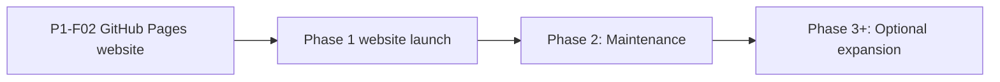

# Roadmap — ParkLoka Website

> Updated automatically by feature-flow execute mode.

## Overview

## Phase 1 — MVP

| Feature | Status | Doc |
|---------|--------|-----|
| P1-F02 GitHub Pages website and legal presence | in-progress | [P1-F02](features/P1-F02-github-pages-website.md) |

## Phase 2 — Maintenance

<!-- One-liners only. A feature gets a doc when its brainstorm happens, not before. -->

- Keep public legal disclosures synchronized with ParkLoka application data flows.
- Refresh screenshots and product copy when shipped features materially change.

## Phase 3+ — backlog

- Add further languages only when supported by the Android application.
