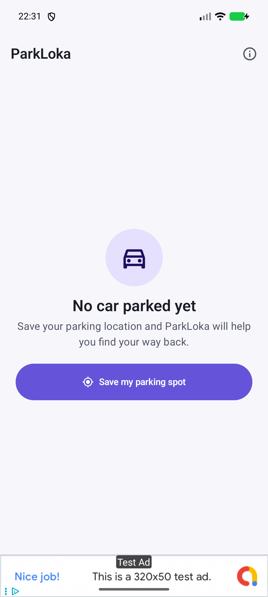
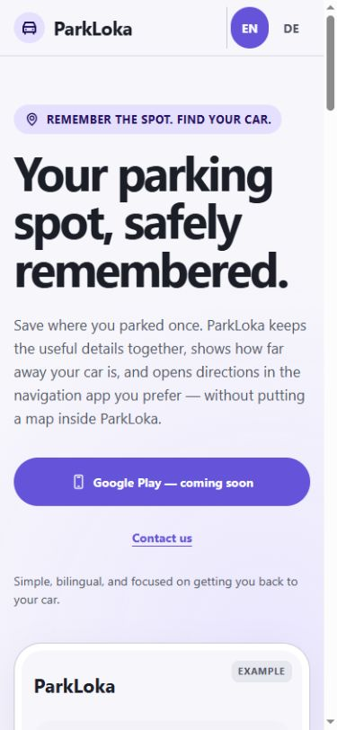
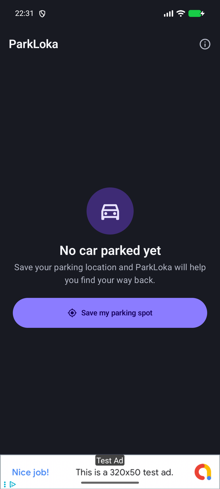
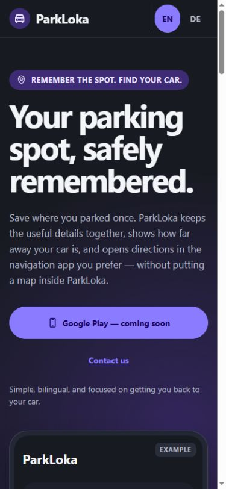
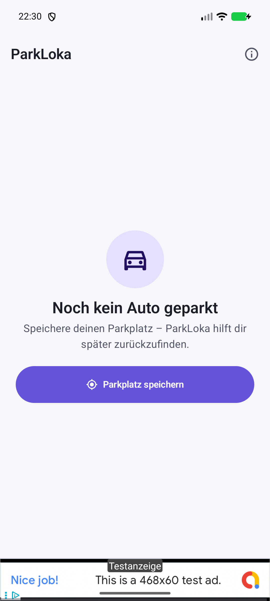
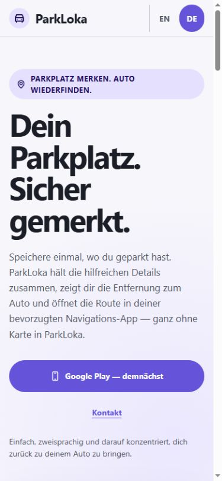
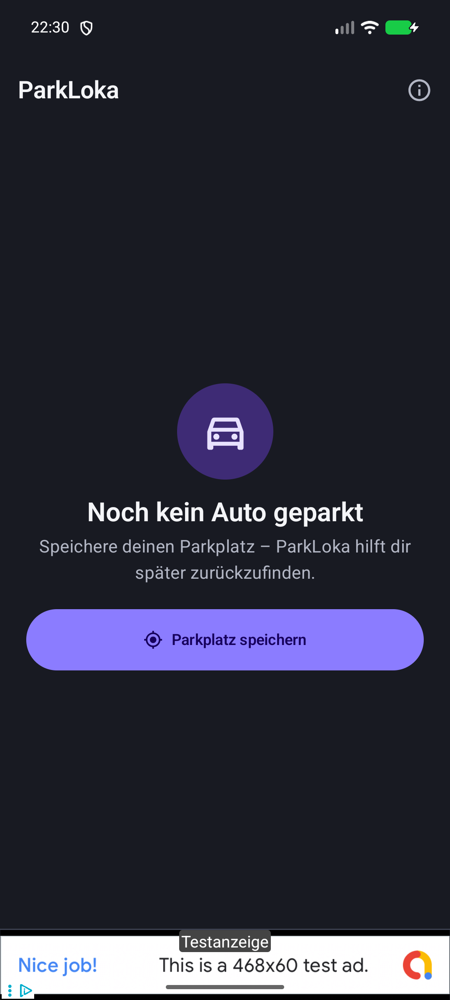
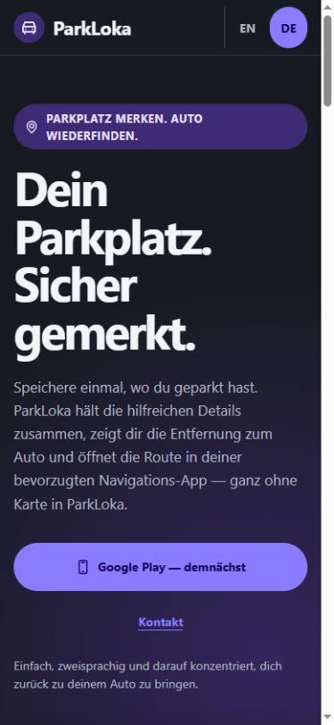

# P1-F02-T5 local release audit

> Verified: 2026-08-19<br>
> Scope: local visual and technical readiness only; no remote, DNS, GitHub Pages, or publication changes

## App and website comparison

The app references are fresh Pixel 8 emulator captures of the current debug APK. The website references use a 390 × 844 browser viewport. The browser did not expose a color-scheme override, so the dark screenshots were rendered from the production `prefers-color-scheme: dark` declarations through an in-memory local test response that changed only the media-query condition. No website source file was changed for those captures.

| State | Android app | Website |
|---|---|---|
| English · light |  |  |
| English · dark |  |  |
| German · light |  |  |
| German · dark |  |  |

The website is a marketing and legal surface rather than an imitation of the app screen. It therefore uses a larger responsive headline and more editorial spacing, while retaining the same visual vocabulary and primary-action hierarchy.

## Shared visual system

| Area | Android source of truth | Website implementation | Result |
|---|---|---|---|
| Light colors | Background `#f7f7fb`, on-background `#1b1d27`, primary `#6554d9`, primary container `#e6e0ff` | Identical semantic custom properties | Pass |
| Dark colors | Background `#181a22`, on-background `#f4f5f8`, primary `#8b7cff`, primary container `#3e2b75` | Identical values under `prefers-color-scheme: dark` | Pass |
| Typography | System font; 28/24/22/16/14/12 type scale | System font stack and matching token scale; responsive marketing headings build on it | Pass |
| Shapes | 6/8/12/20/28 dp rounded-shape scale | 6/8/12/20/28 px shape properties | Pass |
| Spacing | 8/16/24 dp item/content/section rhythm | 8/16/24 px spacing properties and 48 px minimum touch target | Pass |
| Icons | Simple outlined 18/24 dp symbols | Local outline SVG sprite at 18/24 px; no third-party icon request | Pass |
| Actions | One prominent purple primary action, quieter supporting actions, semantic destructive colors | Primary Play action, secondary/contact links, and the same semantic action tokens | Pass |

All 18 tested foreground/background pairs pass the automated thresholds: at least 4.5:1 for normal text and 3:1 for focus indicators. The lowest normal-text result is the dark primary action at 5.41:1; focus rings are 5.14:1 in light mode and 5.31:1 in dark mode.

## Responsive route matrix

The following routes were loaded in the browser at 390 × 844 and 1280 × 900. Each produced visible content, exactly one `main`, exactly one `h1`, the expected document language and canonical URL, and no horizontal overflow:

- `/`
- `/de/`
- `/privacy/`
- `/de/datenschutz/`
- `/legal/`
- `/de/impressum/`
- `/404.html`
- an unknown path using the branded HTTP 404 response

HTTP verification also returned 200 for `sitemap.xml`, `robots.txt`, and `app-ads.txt`; the unknown route returned 404. `app-ads.txt` was served as `text/plain; charset=utf-8` and contains only the confirmed public publisher record.

## Accessibility and performance

- Semantic HTML checks cover document language, one main landmark, one top-level heading, unique IDs, image alternatives, local anchors, and the absence of scripts, inline interaction handlers, and negative tab indices.
- Keyboard structure uses native links in source order, a first-position skip link to `#main-content`, 48 px targets for primary navigation, and a 3 px `:focus-visible` ring.
- The reduced-motion audit produced `scroll-behavior: auto`, `animation-duration: 0.01ms`, one animation iteration, and `transition-duration: 0.01ms` from the production reduced-motion block.
- The public static payload is 282,269 bytes, below the 512 KiB release budget. Every HTML file is below 64 KiB and the CSS is below 48 KiB.
- The landing page makes no script, analytics, font, tracker, or cross-origin runtime requests, and the browser console reported no warnings or errors.

## Metadata and legal readiness

- All six indexable EN/DE routes have exact canonical, English, German, and x-default alternates.
- Landing pages link to the language-matched privacy and legal routes; legal counterparts cross-link through the shared navigation.
- The sitemap contains the six canonical routes and excludes the 404 page; the 404 page declares `noindex`.
- The confirmed AdMob publisher line is present, while the application ID and banner/interstitial ad-unit IDs are absent from the public website repository.
- The legal text remains visibly marked for the owner's final legal and release-dependency review before publication, as required by P1-F02-T3.

## Reproduce locally

```powershell
node scripts/check-site.mjs
node scripts/check-contrast.mjs
```

P1-F02 is locally ready for T6. T6 still requires explicit authorization before adding the remote, renaming the branch, pushing, configuring GitHub Pages or DNS, or publishing the site.
